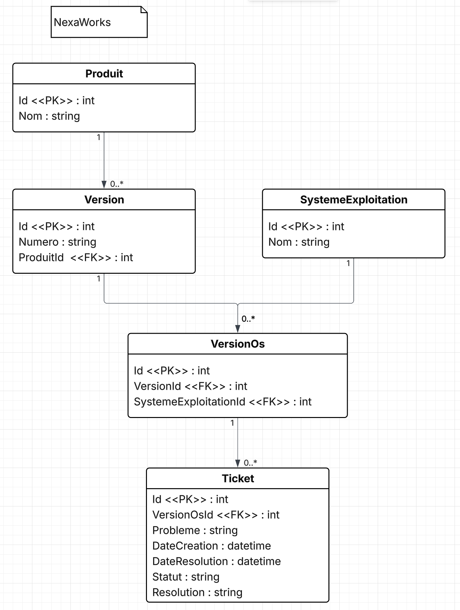
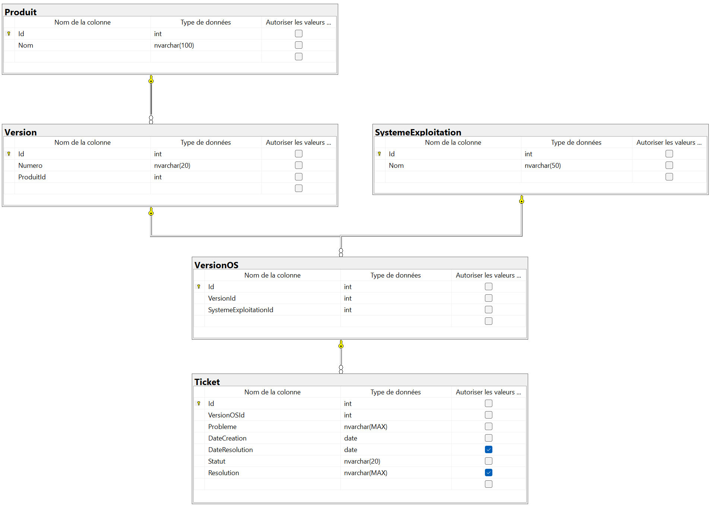

# NexaWorks - Base de données de suivi des problèmes produits

Modélisation et création d'une base de données pour une application .NET

## Contexte

NexaWorks développe plusieurs logiciels. Chaque produit a plusieurs versions et chaque version est compatible avec plusieurs systèmes d'exploitation (Windows, MacOS, Linux, Android, iOS, Windows Mobile). 
L'entreprise doit suivre les problèmes rencontrés sur chaque version et système ainsi que leur résolution.

Ce dépôt contient la base de données SQL Server qui répond à ce besoin avec 25 tickets d'exemple et la procédure de requête.

## Contenu du dépôt

| Élément | Contenu |
|---|---|
| `scripts/01_creation_tables_nexaworks.sql` | Création de la base `NexaWorksDb` et des 5 tables |
| `scripts/02_donnees_nexaworks.sql` | Produits, systèmes d'exploitation, versions et compatibilités |
| `scripts/03_tickets_nexaworks.sql` | Les 25 tickets d'exemple |
| `scripts/04_procedure_rechercher_tickets.sql` | Procédure stockée `RechercherTickets` |
| `scripts/05_appels_nexaworks.sql` | Les 20 appels correspondant aux 20 requêtes demandées |
| `backup/NexaWorksDb.bak` | Sauvegarde complète de la base |
| `documentation/` | Documentation des requêtes et document des tickets |
| `images/` | Modèle entité-association et diagramme SSMS |

## Modèle entité-association



La base compte 5 entités :

- **Produit** : un logiciel NexaWorks.
- **Version** : une version d'un produit (un produit a plusieurs versions).
- **SystemeExploitation** : un système sur lequel une version peut fonctionner.
- **VersionOS** : table de liaison qui représente une combinaison valide "cette version fonctionne sur ce système".
- **Ticket** : un problème signalé sur une combinaison version/OS précise.

Diagramme généré par SSMS à partir de la base réelle :



## Requêtes

Les 20 requêtes demandées sont couvertes par une procédure stockée, `RechercherTickets`. Tous les paramètres sont optionnels : `Null` signifie "ne pas filtrer sur ce critère".

| Paramètre | Rôle |
|---|---|
| `@Statut` | `EnCours` ou `Resolu` ; `NULL` pour les deux |
| `@NomProduit` | Nom exact du produit ; `NULL` pour tous |
| `@NumeroVersion` | Numéro de version ; `NULL` pour toutes |
| `@DateDebut`, `@DateFin` | Période, sur la date de création du ticket |
| `@MotsCles` | Mots séparés par des virgules ; un ticket est retourné s'il contient au moins un des mots dans le champ `Probleme` |

Exemple :

```sql
EXEC RechercherTickets @Statut = 'EnCours', @NomProduit = 'Trader en Herbe';
```

## Utilisation 

Prérequis : SQL Server 2017 ou plus récent.

**Option A - Exécuter les scripts.** Dans SSMS, ouvrir et exécuter en entier les fichiers du dossier `scripts`, dans l'ordre de 01 à 05. Attention : le script 01 supprime la base `NexaWorksDb` si elle existe déjà.

**Option B - Restaurer la sauvegarde.** Sauvegarde avec SQL Server 2025 (version 17.x). Dans SSMS : clic droit sur *Base de données* → *Restaurer la base de données...* → Cocher *Support* puis cliquer sur *...* → *Ajouter* chercher et sélectionner le fichier `NexaWorksDb`. Cliquer sur *OK* pour finaliser.

## Documentation

La documentation des tickets et requêtes se trouve dans le dossier `documentation`.
